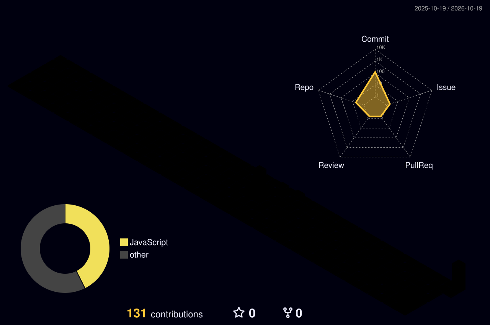

<h1 align="center">#include &lt;brain.h&gt; Hello World!</h1>

  I'm mchany, a high school student developer from South Korea🇰🇷

  
  
  
  

### About Me

안녕하세요! 대한민국에 사는 고등학생 개발자 mchany입니다.

처음에는 C를 배웠고, 현재는 JavaScript를 이용해 프로젝트를 개발하고 있습니다. Python과 Kotlin도 배우고 있으며, 앞으로 Kotlin으로 Android 프로젝트를 만들어 보고 싶습니다.

I'm mchany, a high school student developer living in South Korea.

I started with C and currently build projects with JavaScript. I'm also learning Python and Kotlin, and I hope to develop Android applications with Kotlin in the future.

### Platform

### Skills

----

